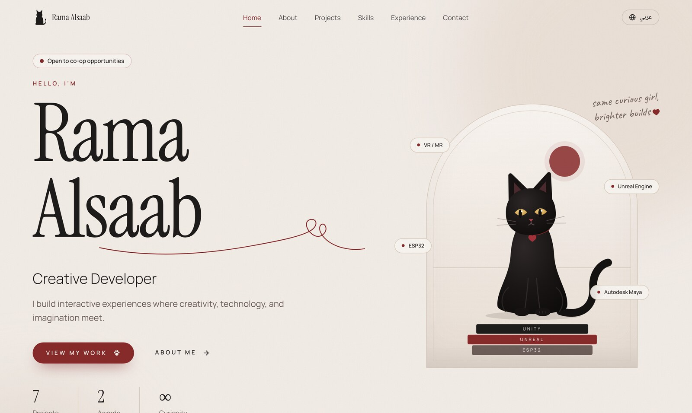

<div align="center">

# Rama Alsaab
### Creative Developer · راما الصعب

Information Technology student at Princess Nourah bint Abdulrahman University (Riyadh).<br>
I build interactive experiences where software, hardware and imagination meet:<br>
VR and mixed reality, game development, embedded systems and 3D modeling.

[LinkedIn](https://www.linkedin.com/in/rama-alsaab-50b152357/) · [Email](mailto:ramaalsaabb@gmail.com) · [CV](public/cv/Rama-Alsaab-CV.pdf)

**Open to co-op opportunities**



</div>

---

## Selected projects

| Project | What it is | Built with |
| --- | --- | --- |
| **THABAT** · ثبات | Mixed-reality bomb-disposal training simulator with an ESP32 + BNO055 haptic glove that measures hand stability. 🏆 **3rd Place — Robotics Track, Defensthon** (2026). My part: the glove electronics and integrating it with the simulator. | Unity · Meta Quest · ESP32 · BNO055 |
| **KATHEEB** · كثيب | VR desert sled simulator for the Expo 2030 Immersive Challenge (Tuwaiq Academy & Misk Skills). A physical sled moves in sync with the ride over WebSocket. | Unity · C# · Meta Quest 3 · ESP32 |
| **SYRAX** | VR and web training platform that simulates financial scams (phishing, impersonation, pressured calls) and scores each decision. Amad Hackathon. | Unity · Meta Quest · Web |
| **VR Mechatronics Lab** | Interactive VR lab teaching Arduino basics: component identification, LED wiring and simulated Arduino programming. Tuwaiq Academy. | Unity · VR · Arduino |
| **Retro Camera** | A retro-style memory camera that shows preloaded photos, from 3D concept to wiring, soldering and a finished prototype. Tuwaiq Academy. | ESP32 · ST7789 display · microSD · 3D design |
| **Deadline** | Game project with a hand-drawn poster featuring a familiar black cat. | Unreal Engine |
| **Maya 3D Modeling** | A stylized house model built in Autodesk Maya. | Autodesk Maya |

Each project has its own case-study page with photos and demo videos, in English and Arabic.

## Skills

**Languages:** C#, Python, Java, JavaScript, SQL<br>
**Immersive & games:** Unity, Unreal Engine, VR / AR / MR, Meta Quest, XR Interaction Toolkit<br>
**Hardware:** ESP32, Arduino, BNO055 and other sensors, electronics prototyping, hardware/software integration<br>
**3D:** Autodesk Maya<br>
**Also:** cybersecurity and networking (CCNA: Introduction to Networks), Git, GitHub, MATLAB

## Certificates & awards

- 🏆 3rd Place, Robotics Track, Defensthon (Team THABAT), 2026
- Certificate of Appreciation, Extracurricular Activities, Faculty of Computer & Information Sciences, PNU, 2026
- VR Development & Emerging Technologies Bootcamp, Tuwaiq Academy (160 hours), 2026
- Mechatronics Engineering Fundamentals Bootcamp, Tuwaiq Academy (100 hours), 2026
- CCNA: Introduction to Networks, Cisco, 2025
- Oracle Java Foundations, Oracle, 2024
- Junior Cybersecurity Analyst Career Path, Cisco Networking Academy, 2024

---

## About this website

Built from scratch with **Next.js**, **React**, **TypeScript**, **Tailwind CSS** and **Motion**:

- 🐈‍⬛ A hand-drawn animated black cat that follows your cursor, blinks, stretches and reacts when you click it
- A custom cursor that changes over projects, buttons and videos
- Full **English / Arabic** support with right-to-left layout
- Projects are plain content files, so adding a new one doesn't need code changes
- Accessible: keyboard navigation, screen-reader labels, reduced-motion support

```bash
npm install
npm run dev   # http://localhost:3000
```

How to add projects, photos and videos, and how to deploy: **[docs/GUIDE.md](docs/GUIDE.md)**
